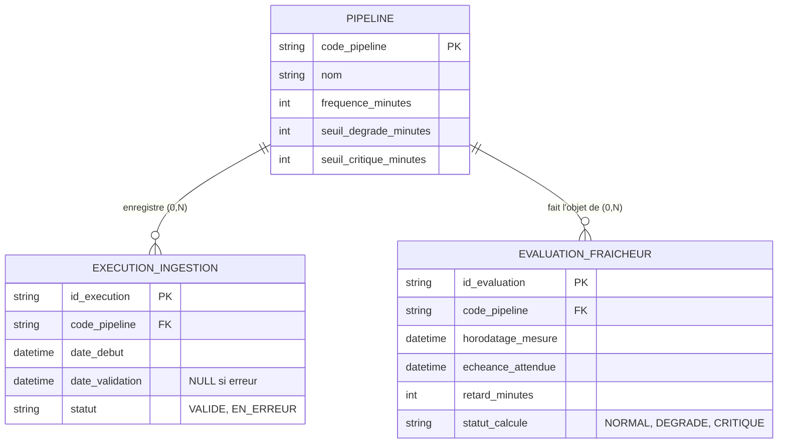

# SPECS.md — Module de Fraîcheur Pipeline & Dashboard

**Date :** 2026-10-22
**Version :** 1.5

## 1. Problématique Métier
Surveiller la fraîcheur d'un pipeline d'ingestion Cloud (ex. flux Billing). Détecter les retards silencieux : un pipeline n'est à jour qu'après validation métier réussie. Restituer l'état via un dashboard interactif.

## 2. Modèle conceptuel de données (MCD)


Ce MCD décrit trois concepts métier et leurs relations ; il n'impose pas une table SQL par entité. Le modèle logique et le modèle physique peuvent être différents. Dans cette application, `PIPELINE` et `EXECUTION_INGESTION` sont persistés dans SQLite. `EVALUATION_FRAICHEUR` est calculée à la demande par `freshness.py` et représentée par `FreshnessResult`, sans table d'évaluations.

## 3. Constitution (Arbitrages Métier)
- Règle 1B (Mesure) : Retard calculé par rapport à l'échéance attendue (dernière exécution valide + fréquence).
- Règle 2B (Critère de succès) : Seules les exécutions avec statut == 'VALIDE' réinitialisent le repère. Les erreurs sont ignorées.
- Règle 3B (Cas Limite) : Si aucune exécution valide n'existe, retard_minutes est None, statut_calcule = 'CRITIQUE'.
- Règle 4A (Seuils) : NORMAL (<= dégradé), DEGRADE (> dégradé ET <= critique), CRITIQUE (> critique).
- Règle 5 (Donnée invalide) : Un statut d'exécution autre que `VALIDE` ou `EN_ERREUR` est une erreur. Le moteur le signale explicitement ; le dashboard affiche une erreur lisible pour le pipeline concerné et continue d'afficher les autres pipelines.

## 4. Architecture et Standards de Développement
- **freshness.py** : Moteur de calcul pur (business logic). Doit être typé (Type hints) et documenté.
- **seed.py** : Script d'amorçage SQLite (`data.db`). Il génère les 4 pipelines et leurs historiques d'exécution.
- **app.py** : Dashboard Streamlit. Il lit SQLite et appelle `freshness.py`.
- **test_freshness.py** : Tests unitaires (Pytest) validant strictly le moteur de calcul avant tout affichage.

### Contrat de `freshness.py` (décision d'architecture validée)
`app.py` lit SQLite ; `freshness.py` est un moteur pur : aucune lecture SQLite, aucune horloge interne. Il reçoit les paramètres du pipeline et ses exécutions déjà lues.

```python
@dataclass(frozen=True)
class Execution:
    statut: str                          # 'VALIDE' ou 'EN_ERREUR'
    date_debut: datetime
    date_validation: datetime | None     # None si erreur

@dataclass(frozen=True)
class FreshnessResult:
    code_pipeline: str
    retard_minutes: float | None
    statut_calcule: str                  # 'NORMAL', 'DEGRADE' ou 'CRITIQUE'

def evaluate_pipeline(
    code_pipeline: str,
    frequence_minutes: int,
    seuil_degrade_minutes: int,
    seuil_critique_minutes: int,
    executions: Sequence[Execution],
    now: datetime,
) -> FreshnessResult
```
- Seule la `date_validation` de la dernière exécution `VALIDE` sert de repère ; `date_debut` n'est jamais utilisée pour le calcul.
- Une exécution `VALIDE` sans `date_validation` ne sert pas de repère. Si aucune autre validation exploitable n'existe, le résultat est `CRITIQUE` avec `retard_minutes = None` (règle 3B).
- Les règles 1B à 4A de la section 3 s'appliquent sans changement.
- Si une exécution a un statut inconnu, `evaluate_pipeline` lève `ValueError` en indiquant le code du pipeline et le statut reçu. Il ne retourne pas de résultat de fraîcheur pour ce pipeline.

### Contrat de configuration de `seed.py` (décision validée)
Le chemin de la base SQLite n'est pas codé en dur ; `seed.py` le résout dans cet ordre de priorité :
1. l'argument explicite `db_path` passé à `seed()` ;
2. la variable d'environnement `DEMO30_DB_PATH` (si elle est définie et non vide) ;
3. la clé `db_path` de `config.yml` (valeur par défaut : `data.db`).

- Un chemin relatif est résolu depuis le dossier du projet (celui de `seed.py`), quelle que soit sa source.
- `.env` n'est jamais lu directement : la variable doit être présente dans l'environnement du processus. `.env` reste dans `.gitignore`.
- `config.yml` est lu par un lecteur minimal sans dépendance. Format accepté : lignes plates `clé: valeur`, lignes vides et lignes de commentaire commençant par `#`. Pas d'imbrication, pas de listes, pas de commentaire en fin de ligne. Des guillemets simples ou doubles autour de la valeur sont retirés.
- La seule clé connue et requise est `db_path`. Une clé inconnue, un doublon, une ligne mal formée, une valeur vide, une clé requise absente ou un fichier introuvable lèvent une erreur lisible (`ConfigError`) qui nomme le fichier et la ligne ; rien n'est ignoré silencieusement.
- Exécuté en ligne de commande, `seed.py` affiche cette erreur et se termine en code 1, sans trace d'exécution.

## 5. Spécifications du Dashboard (app.py)
L'interface Streamlit doit inclure :
1. Un titre clair et un contexte.
2. Un panneau de contrôle avec des boutons ou un menu déroulant pour injecter/activer les 4 scénarios de données (Nominal, Retard, Erreur, Zéro validation) afin de simuler l'évolution en direct.
3. Un affichage visuel de l'état des pipelines (ex: pastilles de couleur Vert/Orange/Rouge).

### Interaction du dashboard (décision validée)
- **Lecture** : `app.py` résout le chemin de la base avec `resolve_db_path()` (contrat de `seed.py`), charge les pipelines et leurs exécutions depuis SQLite, construit des `Execution` et appelle `evaluate_pipeline` avec l'heure courante. Hors bouton d'actualisation, la base est ouverte en lecture seule et n'est jamais modifiée.
- **États** : tous les pipelines présents dans la base (quatre avec les données d'amorçage) sont affichés avec un état visuel : NORMAL = vert, DEGRADE = orange, CRITIQUE = rouge. Aucun identifiant de pipeline n'est codé en dur dans l'interface.
- **Sélecteur** : une liste déroulante alimentée par la base permet d'examiner un scénario (un pipeline) : son état, son retard (« aucune validation » si `None`) et ses exécutions.
- **Bouton « Actualiser les scénarios »** : appelle `seed()` pour régénérer les données relativement à l'heure courante. C'est la seule écriture du dashboard.
- **Base absente ou illisible** : message lisible indiquant que la base est introuvable et qu'il faut cliquer sur « Actualiser les scénarios » pour la créer. Une `ConfigError` est aussi affichée en clair, sans trace d'exécution.
- **Statut d'exécution inconnu** : le pipeline concerné affiche une erreur lisible contenant son code et le statut reçu. Les autres pipelines restent visibles et évalués. L'application continue de fonctionner ; cette erreur ne déclenche aucune écriture.
- **Dépendance** : `streamlit`, déclarée dans `requirements.txt`. Aucune autre dépendance d'exécution.

## 6. Scénarios d'acceptation (Moteur & Data)
- Cas 1 (Nominal) : PL-101 (60 min). Dernier run VALIDE il y a 30 min. Retard attendu : 0 min -> NORMAL.
- Cas 2 (Retard léger) : PL-102 (60 min, seuils 30/60). Dernier run VALIDE il y a 105 min. Retard attendu : 45 min -> DEGRADE.
- Cas 3 (Erreurs ignorées) : PL-103 (60 min, seuils 30/60). Dernier run VALIDE il y a 140 min, run EN_ERREUR il y a 10 min. Retard attendu : 80 min -> CRITIQUE.
- Cas 4 (Zéro validation) : PL-104 (60 min). Aucune exécution valide. Retard attendu : None -> CRITIQUE.
